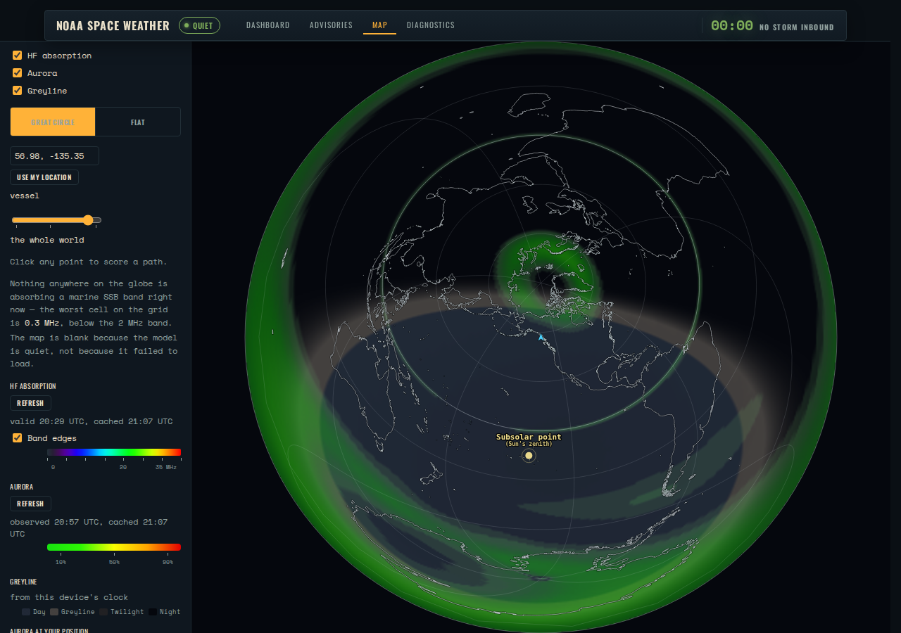
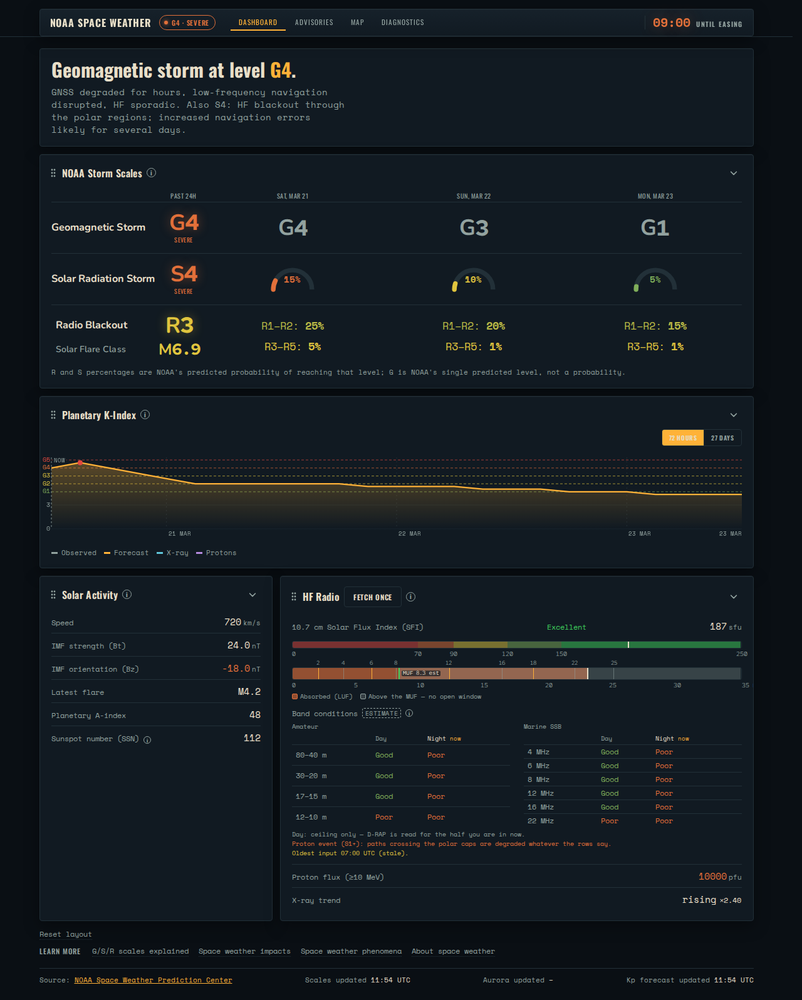
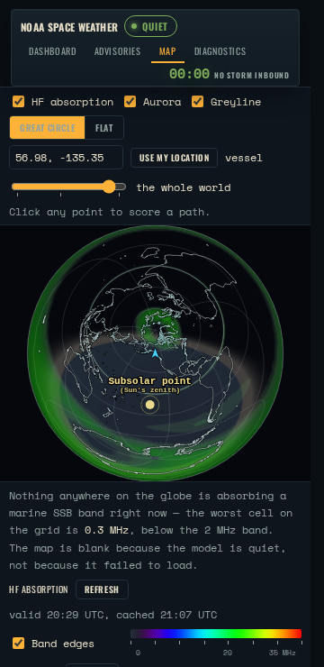

# space-weather

**[Open the app](https://mark-brannan.github.io/space-weather/)** -- live
NOAA data, fetched by your own browser, with no server behind it and
nothing to install. Or the same page on
**[a saved day](https://mark-brannan.github.io/space-weather/?snapshot)**.

[](https://mark-brannan.github.io/space-weather/)

Space weather is what the sun does to radio and navigation down here. A
flare blacks out HF on the daylight side of Earth; a geomagnetic storm makes
GPS wander, degrades satellite links and brings the aurora south. This page
reads NOAA's [Space Weather Prediction Center](https://www.swpc.noaa.gov/)
and answers the first question first: is anything happening right now?

## What it shows

- **Dashboard.** Storm scales now and three days out, the Kp chart, solar
  wind, HF bands open where you are.
- **[Advisories](screenshots/goldens/snapshot-advisories-dark-1280.png).**
  NOAA's weekly outlook and a week of alerts, watches and warnings, in
  NOAA's words.
- **Map.** Aurora and HF absorption on a globe centred on you; the
  greyline; click to score a radio path.
- **[Diagnostics](screenshots/goldens/storm-diagnostics-dark-1280.png).**
  What the page fetched from NOAA, endpoint by endpoint, against what it
  should have cost.



*A G4 storm. The real thing comes a few times a solar cycle, so this one is
the test rig's; the page is the shipping page.*



*It fits a phone, and installs as an app from the browser menu.*

## Three ways to run it

- **In a browser.** The map centres on your position if you allow it, else
  on a stand-in spot off Alaska.
- **On a boat.**
  [signalk-noaa-space-weather](https://github.com/mark-brannan/signalk-noaa-space-weather)
  runs it inside Signal K.
- **In your own code.** `npm install space-weather`: parsers, products, the
  page. [CLAUDE.md](CLAUDE.md) maps it.

## What it publishes

A few of the paths, with real values from a quiet day. Units are SI (m/s,
tesla, hertz, probabilities from 0 to 1); the NOAA scales and Kp are bare
numbers.

```json
{
  "environment.noaa.swpc.scales.observations.latest.G": 0,
  "environment.noaa.swpc.kp.observed": 1.67,
  "environment.noaa.swpc.kp.forecast.max72h": 3.67,
  "environment.noaa.swpc.solar_wind.speed": 340000,
  "environment.noaa.swpc.solar_wind.Bt": 5e-9,
  "environment.noaa.swpc.xray_flare.class": "B4.6",
  "environment.noaa.swpc.aurora.probability": 0,
  "environment.noaa.swpc.drap.highest_affected_frequency": 100000
}
```

## Development

```shell
npm install && npm run build && npm test
```

Tests run with no network, against dated NOAA captures in `examples/`.
[CONTRIBUTING.md](CONTRIBUTING.md) has the setup and the rules,
[docs/development.md](docs/development.md) the rig that shows the page
without a server, and [CLAUDE.md](CLAUDE.md) the architecture and the
constraints that bite.

## Licence

[AGPL-3.0-or-later](LICENSE), with an additional permission under section 7
of the AGPL, stated at the end of LICENSE. Copyright (c) 2025-2026 Mark Brannan.

The permission is transitive only. A program that has this package in its
process because a plugin it runs depends on it -- Signal K server running
signalk-noaa-space-weather, or an image shipping that combination -- does not
become subject to the AGPL by doing so. A program that imports this package
directly gets the plain AGPL, section 13 included.

Patches are welcome and are licensed the same way, with one extra step: the
[CLA](CLA.md) is a one-line statement in your first pull request. It keeps
the copyright in one place so the code can also be offered under other terms
later.
